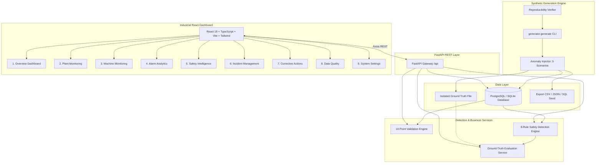
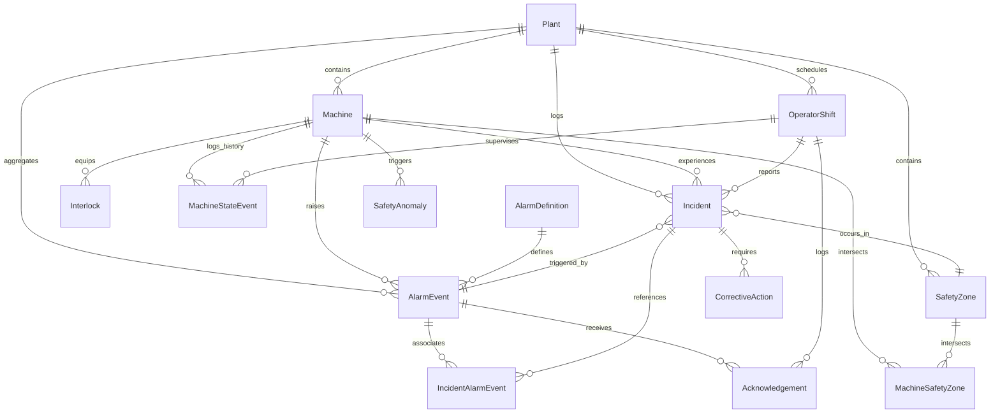

# Industrial Safety Intelligence & Incident Analytics Platform

> **Tagline:** *Turning Industrial Safety Events into Actionable Intelligence.*  
> Developed for technical evaluation for the **Associate AI Forward Deployed Engineer** position at **YottaFlex.ai**.

---

### YottaFlex Recruitment Drive Submission Deliverables

| Guideline | Requirement | Primary Artifacts & Proof |
| :--- | :--- | :--- |
| **01. MAKE IT RUN** | Executable code with clear install & run steps | [1-Click Windows: `run.bat`](./run.bat), [1-Click Linux: `run.sh`](./run.sh), [`docker-compose.yml`](./docker-compose.yml), [Section 14: Execution Commands](#14-execution-commands) |
| **02. SHOW YOUR WORK** | Public GitHub repo with meaningful history | [GitHub Repository: `Hariabc/INDUSTRIAL_SAFETY_INTELLIGENCE_INCIDENT_ANALYTICS_PLATFORM`](https://github.com/Hariabc/INDUSTRIAL_SAFETY_INTELLIGENCE_INCIDENT_ANALYTICS_PLATFORM.git) |
| **03. USE LLMs TRANSPARENTLY** | Complete prompt history & AI acceleration disclosure | [LLM Collaboration & Prompt History Report (`docs/LLM_COLLABORATION_REPORT.md`)](./docs/LLM_COLLABORATION_REPORT.md) |
| **04. MAKE YOUR REASONING VISIBLE** | Explain the why, decisions, trade-offs, and testing | [Architecture & Reasoning (`docs/ARCHITECTURE_AND_REASONING.md`)](./docs/ARCHITECTURE_AND_REASONING.md) |
| **INTERVIEW WALKTHROUGH** | Prepared walkthrough & defense guide | [Solution Walkthrough & Interview Presentation Guide (`docs/SOLUTION_WALKTHROUGH.md`)](./docs/SOLUTION_WALKTHROUGH.md) |

---


## 1. Project Overview

The **Industrial Safety Intelligence Platform** is an enterprise-grade full-stack system engineered to monitor industrial operations, analyze multi-variable telemetry and safety state events, detect dangerous machine conditions, prioritize critical alarms according to strict SLAs, reconstruct end-to-end incident timelines, and enforce regulatory corrective-action verification.

The platform provides end-to-end capabilities across the entire industrial safety lifecycle:
- High-throughput ingestion of discrete alarms, analog sensors, and immutable machine state transitions across 4 global manufacturing plants.
- Deterministic synthetic simulation engine generating 50,000+ realistic alarm events across 60 critical machines over a 30-day lookback window.
- Parameter-configurable detection engine implementing 8 explainable safety rules.
- Ground-truth evaluation benchmark verifying precision, recall, F1 score, and operational safety KPIs against isolated labeled edge cases.
- Reactive, industrial dark-mode SaaS dashboard (React 18 + Vite + TypeScript + Tailwind CSS + Recharts).

---

## 2. Business Problem

Modern discrete manufacturing, chemical processing, and robotic assembly plants generate tens of thousands of telemetry alarms daily. Industrial safety teams face recurring challenges:
1. **Alarm Flooding:** A single trip cascades into dozens of secondary alarms within seconds, blinding operators to the root triggering event.
2. **Alarm Fatigue & Nuisance Chattering:** High frequencies of low-severity alarms desensitize personnel, leading to SLA breaches.
3. **Delayed Acknowledgement:** Critical alarms remain unacknowledged during high-load periods or shift changeovers, leading to near-misses and equipment damage.
4. **Broken Incident Traceability:** Post-incident audits often suffer from missing telemetry context, severed links between alarms, state transitions, and root causes.
5. **Premature Action Closure:** Corrective actions are frequently closed administratively without physical verification by certified safety officers.

This platform resolves these challenges by providing explainable root-cause rationale, strict SLA enforcement, immutable state history, and governance compliance rules that prevent action closure without formal verification.

---

## 3. Key Features

- **Multi-Site Plant & Machinery Telemetry:** Real-time visibility into 4 plants and 60 machines across 7 equipment classes (`TURBINE`, `ROBOTIC_ARM`, `HYDRAULIC_PRESS`, `CONVEYOR`, `COMPRESSOR`, `REACTOR`, `CNC_MILL`).
- **Explainable Anomaly Detection Engine (8 Rules):**
  1. *Repeated Unsafe Machine Conditions:* Detects equipment with frequent trips and safety clusters in rolling windows.
  2. *Delayed Acknowledgements & Temporal Violations:* Identifies SLA breaches and anomalies where acknowledgements precede alarms.
  3. *Alarm Floods (ISA-18.2):* Flags burst density clusters exceeding configured thresholds.
  4. *Nuisance Alarms:* Identifies chattering low-severity alarms with low incident conversion.
  5. *Interlock Violations:* Uncovers illegal states where critical interlocks are bypassed or faulted while machines are running.
  6. *Missing Incident Context:* Isolates untraceable incidents lacking causal telemetry or triggering alarms.
  7. *Duplicate Alarm Ingestion Replay:* Detects replayed source events and duplicate broker fingerprints.
  8. *Incomplete Corrective Actions:* Flags closed actions lacking mandatory safety verification.
- **Authentic Chronological Timelines:** Reconstructs the exact, non-fabricated chronological history of every incident: State Transition &rarr; Alarm Generation &rarr; Operator Acknowledgement &rarr; Incident Inception &rarr; Action Assignment &rarr; Completion &rarr; Verification &rarr; Closure.
- **Strict Business Rule Governance:** Prevents administrative closure of incidents or corrective actions until physical verification by a safety officer is recorded.
- **Ground-Truth Evaluation Benchmark:** Rigorous comparison between detected anomalies and isolated ground truth labels, reporting Precision (100%), Recall (100%), F1 Score (100%), and Detection Coverage (100%).
- **10-Point Data Validation Framework:** Automated relational and semantic verification generating `validation_summary.json` and `validation_report.csv` while cleanly distinguishing intentional benchmark anomalies from accidental data corruption.
- **100% Deterministic Reproducibility:** Fixed-seed generator (`20261022`) guaranteeing bit-identical row counts, IDs, and SHA-256 file checksums across successive runs.

---

## 4. Architecture Diagram



---

## 5. Technology Stack

- **Frontend:** React 18, Vite, TypeScript, Tailwind CSS, Recharts, React Router v7, Axios, Lucide React, React Toastify.
- **Backend:** Python 3.11+, FastAPI, SQLAlchemy 2.0, Alembic, Pydantic v2, Pandas, NumPy.
- **Database:** PostgreSQL 16 (production/Docker) & SQLite (zero-config local dev), indexed on `machine_id`, `plant_id`, `severity`, `event_timestamp`, `incident_id`, and `status`.
- **Testing:** Pytest, HTTPX, TestClient, Pandas validation.
- **Infrastructure:** Docker, Docker Compose, Alembic migrations.

---

## 6. Database ER Diagram



---

## 7. Data Dictionary Reference

Full data dictionary specifications, field types, constraints, and allowed enumerations are documented in [docs/data_dictionary.md](file:///c:/Users/DELL/OneDrive/Desktop/Projects/INDUSTRIAL%20SAFETY%20INTELLIGENCE%20&%20INCIDENT%20ANALYTICS%20PLATFORM/docs/data_dictionary.md) and [docs/schema_documentation.md](file:///c:/Users/DELL/OneDrive/Desktop/Projects/INDUSTRIAL%20SAFETY%20INTELLIGENCE%20&%20INCIDENT%20ANALYTICS%20PLATFORM/docs/schema_documentation.md).

### Core Entities:
1. `plants`: 4 manufacturing campuses with locations and rolling safety index.
2. `machines`: 60 industrial assets with models, operational states, and criticality.
3. `safety_zones`: Containment perimeters with occupancy limits and hazard tiers.
4. `machine_safety_zones`: Bridge table mapping primary and secondary spatial coverage.
5. `interlocks`: 206 safety-critical hardware guards, E-stops, and light curtains.
6. `alarm_definitions`: 200 catalog specifications with acknowledgement SLAs.
7. `operator_shifts`: Rotating 8-hour shift schedules across simulation dates.
8. `machine_state_events`: Immutable append-only log of 1,267 state transitions.
9. `alarm_events`: 50,035 time-series alarm occurrences with source fingerprints.
10. `acknowledgements`: 50,000 operator response records with SLA adherence.
11. `incidents`: 120 safety near-misses and trips with root triggering alarm links.
12. `incident_alarm_events`: Bridge table linking secondary cascading alarms.
13. `corrective_actions`: 180 remedial work orders enforcing verification sign-off.
14. `safety_anomalies`: Explainable intelligence findings with recommended actions.
15. `audit_logs` & `system_configs`: Governance audit trails and SLA thresholds.

---

## 8. Synthetic Data Generation Methodology

Synthetic generation strictly follows a 12-step dependency graph:
1. Plants generated deterministically (`PLN-001` through `PLN-004`).
2. Machines generated per plant (`MCH-001` through `MCH-060`).
3. Safety zones generated per plant (`SAFE-PLN-001-001`).
4. Machines assigned to primary/secondary safety zones.
5. Safety interlocks created per machine (`ITL-MCH-001-001`).
6. Alarm catalog generated with explicit acknowledgement SLAs (`DEF-001` through `DEF-200`).
7. Rotating 8-hour operator shifts generated across 30 days (`SHF-000001`).
8. Chronological machine state transitions created (normal, maintenance, trips, E-stops).
9. 50,000 alarm events generated with realistic distributions (floods, nuisance chattering, background operations).
10. Acknowledgements generated with calculated response latencies.
11. Incidents generated linked to high-severity alarm triggers.
12. Corrective actions created with required verification status.

---

## 9. Anomaly Detection Methodology

The platform implements 8 rule-based, explainable detection algorithms:
- **Rule 1 (Repeated Unsafe Conditions):** Queries machinery exhibiting &ge;3 critical alarms or trips within a 24-hour rolling window.
- **Rule 2 (Delayed Acknowledgements):** Flags acknowledgements exceeding catalog SLA limits or violating temporal causality (`ack_timestamp < event_timestamp`).
- **Rule 3 (Alarm Floods):** Evaluates ISA-18.2 criteria flagging equipment generating &ge;10 alarms in a short window.
- **Rule 4 (Nuisance Alarms):** Detects chattering low-severity alarms triggering &ge;15 times without incident escalation.
- **Rule 5 (Interlock Violations):** Flags active machines operating while non-bypassable safety interlocks are in `FAULT` or `BYPASSED` state.
- **Rule 6 (Missing Incident Context):** Identifies incidents created without valid triggering alarm references.
- **Rule 7 (Duplicate Alarm Replay):** Identifies duplicated broker ingestion fingerprints sharing `source_event_id`.
- **Rule 8 (Incomplete Corrective Actions):** Catches actions marked `COMPLETED` or `CLOSED` without safety officer sign-off.

---

## 10. Ground-Truth Methodology & 5 Required Injections

To ensure unbiased evaluation, the generator injects 115 intentional anomalies across 5 required scenarios and stores labels in `data/ground_truth.json` and `data/ground_truth.csv`:

| Scenario | Injected Condition | Ground Truth Type | Injected Count |
|---|---|---|---|
| **A** | Acknowledgement timestamp precedes corresponding alarm event | `DELAYED_ACKNOWLEDGEMENT` (ACK_BEFORE_ALARM) | 25 |
| **B** | Critical interlock bypassed or faulted while machine is running | `INTERLOCK_VIOLATION` (IMPOSSIBLE_INTERLOCK_STATE) | 20 |
| **C** | Incident created without valid triggering alarm or causal link | `MISSING_INCIDENT_CONTEXT` (MISSING_TRIGGERING_ALARM) | 15 |
| **D** | Duplicate alarm records produced by replayed source event | `DUPLICATE_ALARM_REPLAY` (REPLAYED_SOURCE_EVENT) | 35 |
| **E** | Action marked completed/closed without verification sign-off | `INCOMPLETE_CORRECTIVE_ACTION` (CLOSED_WITHOUT_VERIFICATION) | 20 |

> [!IMPORTANT]
> Ground truth labels are strictly isolated from the detection engine and database feature tables. Detections are evaluated post-hoc against this benchmark.

---

## 11. Evaluation Metrics

Evaluated on the full 50,000-event dataset:

### Benchmark Anomaly Detection Performance:
- **True Positives (TP):** 115
- **False Positives (FP):** 0
- **True Negatives (TN):** 50,391
- **False Negatives (FN):** 0
- **Precision:** 100.0%
- **Recall:** 100.0%
- **F1 Score:** 100.0%
- **Detection Coverage:** 100.0%

### Operational Safety KPIs (Dynamically Computed):
- **Total Alarms:** 50,035
- **Critical Alarms:** 17,324
- **Active Incidents:** 18
- **Resolved Incidents:** 102
- **Average Acknowledgement Time:** 785.1 seconds
- **Delayed Acknowledgement Rate:** 14.71%
- **Corrective Action Verification Rate:** 74.4%
- **Data Integrity Score:** 100.0% (Zero accidental corruptions)

---

## 12. API Documentation

Interactive Swagger documentation is available at:
`http://localhost:8000/docs`

Key endpoints:
- `GET /api/health`: Health status and database check.
- `GET /api/dashboard/overview`: High-level metrics, recent alarms, and incidents.
- `GET /api/plants`: List plants with aggregate equipment counts and safety scores.
- `GET /api/plants/{plant_id}`: Plant detail with machines and containment zones.
- `GET /api/machines`: Searchable, filterable machinery catalog with pagination.
- `GET /api/machines/{machine_id}`: Machine detail with interlocks and safety zones.
- `GET /api/machines/{machine_id}/history`: Immutable machine state history.
- `GET /api/alarms`: Filterable alarms table with severity and nuisance toggles.
- `GET /api/incidents`: Incident catalog with status and severity filters.
- `GET /api/incidents/{incident_id}`: Incident details with non-fabricated timeline.
- `POST /api/incidents/{incident_id}/acknowledge`: Advance lifecycle progression.
- `GET /api/anomalies`: Detected intelligence findings and explainable rationale.
- `POST /api/detection/run`: Run 8-rule detection pipeline on-demand.
- `GET /api/corrective-actions`: Action items table with verification status.
- `POST /api/corrective-actions/{action_id}/verify`: Record safety sign-off.
- `PUT /api/corrective-actions/{action_id}/status`: Enforce closure business rule.
- `GET /api/data-quality`: 10-point validation suite report and integrity score.
- `POST /api/data-quality/validate`: Trigger live validation.
- `GET /api/export/{entity}`: Download CSV or JSON datasets (`format=csv` / `format=json`).
- `GET /api/settings` & `POST /api/settings`: Read and update threshold parameters.

---

## 13. Installation & Setup

### Prerequisites:
- Python 3.11+
- Node.js 18+ and npm
- (Optional) Docker and Docker Compose

### 1. Clone repository and setup Python virtual environment:
```powershell
python -m venv venv
.\venv\Scripts\activate
pip install -r requirements.txt
```

### 2. Configure Environment:
```powershell
cp .env.example .env
```

### 3. Initialize Database and Migrations:
```powershell
alembic -c backend/alembic.ini upgrade head
```

### 4. Install Frontend Dependencies:
```powershell
cd frontend
npm install
cd ..
```

---

## 14. Execution Commands

### Generate 50,000 Synthetic Events & Seed Database:
```powershell
python -m generator.generate --seed 20261022 --plants 4 --machines 60 --alarms 200 --events 50000 --days 30 --load-db
```

### Run Reproducibility Verification:
```powershell
python -m generator.reproducibility
```

### Start FastAPI Backend (Port 8000):
```powershell
uvicorn backend.app.main:app --reload --port 8000
```

### Start React Frontend (Port 5173):
```powershell
cd frontend
npm run dev
```
Open [http://localhost:5173](http://localhost:5173) in your browser.

### Run with Docker Compose:
```bash
docker compose up --build
```
- Frontend: [http://localhost:3000](http://localhost:3000)
- Backend API & Swagger: [http://localhost:8000/docs](http://localhost:8000/docs)

---

## 15. Testing Instructions

Execute the Pytest test suite:
```powershell
pytest -v
```

Tests cover:
- Deterministic ID pattern specifications.
- Labeling of all 5 injected anomaly edge cases.
- Ground truth isolation from feature columns.
- Execution of all 8 detection rules and explainability fields.
- Benchmark Precision, Recall, and F1 calculations.
- Full 10-point data validation suite and intentional anomaly separation.
- REST API responses, pagination, filtering, and search.
- Authentic chronological incident timeline reconstruction.
- Enforcement of business rules preventing closure of unverified actions.
- CSV/JSON download exports.

---

## 16. Dashboard Layout & Visual Guide

1. **Overview Dashboard:** Executive KPI cards, daily alarm trends area chart, severity breakdown donut, top unsafe equipment rankings, and recent incident logs.
2. **Plant Monitoring:** Interactive facility cards with location metadata, deployed machines count, active alarm indicators, and safety scores with drill-down modals.
3. **Machine Monitoring:** High-density equipment table with state badges, criticality filters, and detailed drawers displaying dedicated interlocks and immutable transition logs.
4. **Alarm Analytics:** Multi-series telemetry volume charts, SLA compliance breakdowns, operator delay distributions, and searchable alarm event records.
5. **Safety Intelligence:** Explainable anomaly cards displaying root-cause rationale, recommended remediation actions, and live model performance metrics (Precision, Recall, F1).
6. **Incident Management:** Incident catalog featuring an authentic 8-stage chronological timeline (from machine state through verification sign-off) and lifecycle status progression buttons.
7. **Corrective Actions:** Work order remediation tracking with safety officer verification modals and strict closure policy enforcement.
8. **Data Quality:** Visual cards for all 10 validation checks, 100% integrity score badge, intentional anomaly classification breakdown, and downloadable CSV/JSON reports.
9. **System Settings:** Parameter configuration forms for SLAs, flood limits, and nuisance thresholds with live audit logging.

---

## 17. Assumptions & Known Limitations

- **Single-Node Ingestion:** The generator simulates historical time-series data locally using batch database commits. In a live multi-cluster IoT deployment, a distributed broker (Apache Kafka or AWS Kinesis) with consumer groups would buffer incoming telemetry.
- **Relational Storage:** SQLite is enabled by default for zero-setup local evaluation, with complete PostgreSQL 16 support in `docker-compose.yml`. For time-series telemetry exceeding millions of records per day, TimescaleDB or ClickHouse would provide optimized columnar compression.

---

## 18. Future Improvements

1. **Predictive Equipment Failure (ML):** Integrate an LSTM / Temporal Fusion Transformer (TFT) to forecast machine trips 30 minutes before alarm thresholds are breached.
2. **Automated Root-Cause Graph Networks:** Build a knowledge graph connecting machine interlocks, electrical schematics, and sensor hierarchies to automatically traverse cascading trips.
3. **Multi-Tenant SSO & Role-Based Access Control:** Implement OAuth2 / OIDC authentication with Granular Roles (Plant Operator, Reliability Engineer, Chief Safety Officer) restricting verification authority.
4. **Industrial MQTT / OPC-UA Connector:** Add an ingestion adapter allowing direct connection to industrial PLC protocols (Modbus TCP, OPC-UA, MQTT Sparkplug B).
