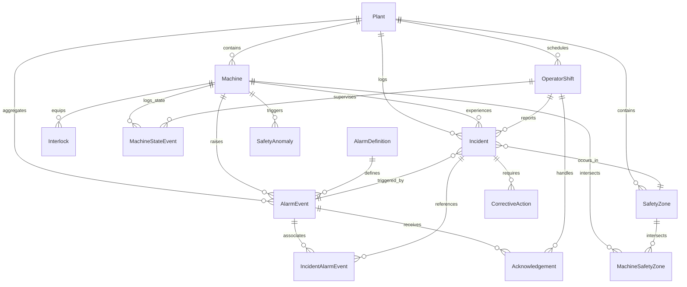

# Database Schema Documentation: Industrial Safety Intelligence Platform

## Entity-Relationship Diagram

---

## Cardinalities and Relationships

1. **Plant -> Machine (1:N)**: A plant contains multiple machines. Each machine belongs strictly to one plant.
2. **Plant -> SafetyZone (1:N)**: A plant contains designated safety zones (e.g. Robot Enclosures, Press Bays).
3. **Machine <-> SafetyZone (M:N via MachineSafetyZone)**: A machine can span or interact with multiple safety zones (Primary, Secondary).
4. **Machine -> Interlock (1:N)**: Each machine is equipped with dedicated physical and electrical interlocks.
5. **Machine -> MachineStateEvent (1:N)**: Immutable append-only log of operational state changes (`RUNNING`, `IDLE`, `TRIPPED`, `EMERGENCY_STOP`, `MAINTENANCE`, `UNSAFE`).
6. **AlarmDefinition -> AlarmEvent (1:N)**: Master catalog defines severity, category, and acknowledgement SLA for alarm occurrences.
7. **AlarmEvent -> Acknowledgement (1:N / 1:1 typical)**: Traceable record of operator response, latency measurement, and SLA conformance.
8. **Incident -> AlarmEvent (M:N via IncidentAlarmEvent & 1:1 triggering)**: An incident has a root triggering alarm and can associate multiple cascading alarms.
9. **Incident -> CorrectiveAction (1:N)**: Incidents generate one or more remedial action items requiring safety officer verification prior to closing.
10. **Machine / Plant -> SafetyAnomaly (1:N)**: Explainable intelligence outputs detecting recurrent unsafe conditions, alarm floods, nuisance alarms, and protocol violations.

---

## Indexing Strategy

To ensure high performance across 50,000+ alarm events, state transitions, and analytical queries, the following compound and single-column indexes are implemented:

- `machines`: `ix_machines_plant_state` (`plant_id`, `current_state`), `ix_machines_criticality` (`criticality`)
- `interlocks`: `ix_interlocks_machine_state` (`machine_id`, `current_state`)
- `machine_state_events`: `ix_state_events_machine_time` (`machine_id`, `timestamp`), `ix_state_events_plant_time` (`plant_id`, `timestamp`)
- `alarm_events`: `ix_alarm_events_machine_time` (`machine_id`, `event_timestamp`), `ix_alarm_events_plant_time` (`plant_id`, `event_timestamp`), `ix_alarm_events_severity_time` (`severity`, `event_timestamp`), `ix_alarm_events_source_event` (`source_event_id`)
- `acknowledgements`: `ix_acknowledgements_alarm_time` (`alarm_event_id`, `ack_timestamp`), `ix_acknowledgements_sla_status` (`sla_status`)
- `incidents`: `ix_incidents_plant_status` (`plant_id`, `status`), `ix_incidents_machine_severity` (`machine_id`, `severity`), `ix_incidents_created_time` (`created_timestamp`)
- `corrective_actions`: `ix_corrective_actions_incident_status` (`incident_id`, `status`), `ix_corrective_actions_priority_due` (`priority`, `due_date`)
- `safety_anomalies`: `ix_anomalies_type_severity` (`anomaly_type`, `severity`), `ix_anomalies_plant_status` (`plant_id`, `status`)
